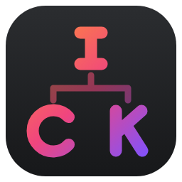
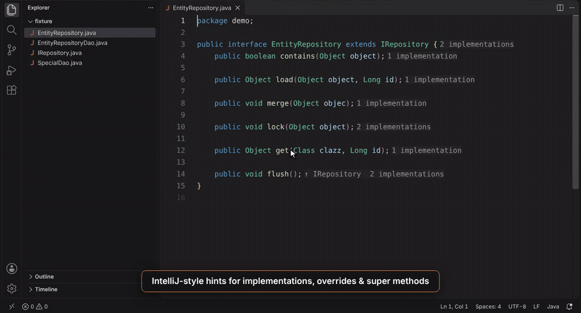

<p align="center">
  
</p>

<h1 align="center">IntelliJ Java/Kotlin Navigation</h1>

<p align="center">
  IntelliJ-style <b>implementation / override / super method</b> navigation for Java and Kotlin in VS Code.
</p>

<p align="center">
  <a href="https://github.com/andreashuthe/intellij-java-kotlin-navigation/actions/workflows/ci.yml"></a>
  <a href="https://github.com/andreashuthe/intellij-java-kotlin-navigation/releases/latest"></a>
  <a href="https://github.com/andreashuthe/intellij-java-kotlin-navigation/blob/HEAD/LICENSE"></a>
</p>

<p align="center">
  
</p>

Miss IntelliJ's *"1 implementation"* hints and the jump between an interface and its implementations?
This extension brings exactly that to VS Code: every interface, class and method gets a small hint showing
where it is implemented, overridden or inherited from — and one **⌘/Ctrl + Click** takes you there.

It is made to work together with JetBrains' official
[Java and Kotlin by IntelliJ IDEA](https://marketplace.visualstudio.com/items?itemName=JetBrains.intellij-server)
extension, but it works with **any** Java/Kotlin language server (Red Hat Java, Oracle Java, Kotlin LSP, …).

## Features

- **Code-vision hints** at the end of each declaration — like in IntelliJ:

  | Hint | Meaning |
  |---|---|
  | `2 implementations` | interface / abstract method is implemented in 2 places |
  | `3 overrides` | method is overridden in 3 subclasses |
  | `1 inheritor` | class is extended once |
  | `↑ EntityRepository` | method implements / overrides a method of `EntityRepository` |
  | `↑ BaseDao +2` | … and 2 more ancestors up the hierarchy |

- **⌘ + Click** (macOS) / **Ctrl + Click** (Windows, Linux) on a hint:
  one target → jump straight there; several targets → a picker like IntelliJ's *"Choose Implementation"*.
- **Hover** a method or type name → popup with clickable links to all targets.
- **Whole hierarchy**: walks up through superclasses and super-interfaces, matching overloads by parameter types.
- **Keyboard commands** for IntelliJ's *Go to Implementation* (`Ctrl+Alt+B`) and *Go to Super Method* (`Ctrl+U`) — see below.
- Optional **CodeLens** (plain click instead of ⌘/Ctrl + Click) and optional **line-number click**.
- Lightweight: only asks the language server via VS Code's standard APIs, caches per file version
  and refreshes after edits and saves.

## Requirements

- VS Code **1.85** or newer (or a compatible editor such as Cursor or Windsurf).
- A Java and/or Kotlin language server extension, for example:
  - [Java and Kotlin by IntelliJ IDEA](https://marketplace.visualstudio.com/items?itemName=JetBrains.intellij-server) (JetBrains)
  - [Language Support for Java by Red Hat](https://marketplace.visualstudio.com/items?itemName=redhat.java)

Hints appear as soon as the language server has finished indexing.

## Usage

| What | How |
|---|---|
| Jump to implementation / super method | **⌘/Ctrl + Click** the hint at the end of the line |
| See all targets | **Hover** the method or type name |
| Plain click instead | enable `intellijNav.codeLens` |
| Keyboard | run *IntelliJ Nav: Go to Implementation(s)* / *IntelliJ Nav: Go to Super Method* from the command palette or bind a key |

IntelliJ-like key bindings (add to your `keybindings.json`):

```jsonc
[
  { "key": "ctrl+alt+b", "command": "intellijNav.goToImplementations", "when": "editorTextFocus && editorLangId =~ /^(java|kotlin)$/" },
  { "key": "ctrl+u",     "command": "intellijNav.goToSuper",           "when": "editorTextFocus && editorLangId =~ /^(java|kotlin)$/" }
]
```

## Settings

| Setting | Default | Description |
|---|---|---|
| `intellijNav.enabled` | `true` | Turn the extension on/off |
| `intellijNav.languages` | `["java", "kotlin"]` | Language IDs to analyse |
| `intellijNav.inlayHints` | `true` | Show the ⌘/Ctrl + clickable hints at the end of declarations |
| `intellijNav.codeLens` | `false` | Show the same links as CodeLens above declarations (plain click, uses an extra line) |
| `intellijNav.clickLineNumber` | `false` | Clicking the line number of a declaration navigates instead of selecting the line |
| `intellijNav.showOnTypes` | `true` | Also show hints on class / interface declarations |
| `intellijNav.refreshDelay` | `1000` | Milliseconds after an edit before hints are recomputed |
| `intellijNav.maxConcurrentRequests` | `4` | Parallel language-server requests per file |

## Commands

| Command | ID |
|---|---|
| IntelliJ Nav: Go to Implementation(s) / Overriding Members | `intellijNav.goToImplementations` |
| IntelliJ Nav: Go to Super Method / Interface | `intellijNav.goToSuper` |
| IntelliJ Nav: Refresh Navigation Hints | `intellijNav.refresh` |

## How it works

For every Java/Kotlin file in a visible editor the extension asks the active language server:

1. **Document symbols** → classes, interfaces and their methods.
2. **↓ Subtypes**: one *Go to Implementation* request per type. Overriding methods are then found by
   matching signatures in those subtypes — a class without subtypes costs no further requests at all.
   (If a subtype can't be inspected, or an abstract method finds no match, the extension falls back to
   asking the server per method.)
3. **↑ Supertypes** via the type hierarchy API — or, if the server doesn't support it, by resolving the
   `extends` / `implements` (Kotlin `:`) clause with *Go to Definition*. Super methods are matched by name
   and parameter types (generic type variables such as `T` match any type, Kotlin `Any`/`Int`/… match
   Java `Object`/`int`/…).

Results for other files are cached and only invalidated when those files change, so re-analysing the file
you are typing in is almost free. Members closest to what's on screen are analysed first and hints appear
progressively. Kotlin classes and members that are `final` by default are skipped.

Everything goes through VS Code's public provider commands, so no language server is bundled and
nothing leaves your machine. Timing information is written to the *IntelliJ Java/Kotlin Navigation* output channel.

## Known limitations

- VS Code only runs inlay-hint links on **⌘/Ctrl + Click**; use `intellijNav.codeLens` for a plain click.
- VS Code doesn't allow extensions to react to clicks on gutter icons, which is why there is no IntelliJ-style gutter icon.
- Supertypes from libraries (e.g. `HibernateDaoSupport`) are only matched when the language server can open their (decompiled) sources.
- Overloads are matched by simple type names; exotic generic overloads can occasionally be ambiguous.

## Contributing

```bash
npm install
npm test                    # unit tests (plain Node)
npm run test:integration    # runs the extension in a real VS Code with a mock Java/Kotlin language server
npm run test:perf           # benchmark on a generated large hierarchy (request counts + timings)
npm run package             # builds the .vsix
```

Press **F5** in VS Code to start an Extension Development Host with the extension loaded.
`scripts/record-demo.js` re-records the demo GIF.

Releases are built by GitHub Actions — see [RELEASING.md](RELEASING.md).

## License

[MIT](LICENSE) © Andreas Huth

*IntelliJ IDEA is a trademark of JetBrains s.r.o. This extension is not affiliated with or endorsed by JetBrains.*
